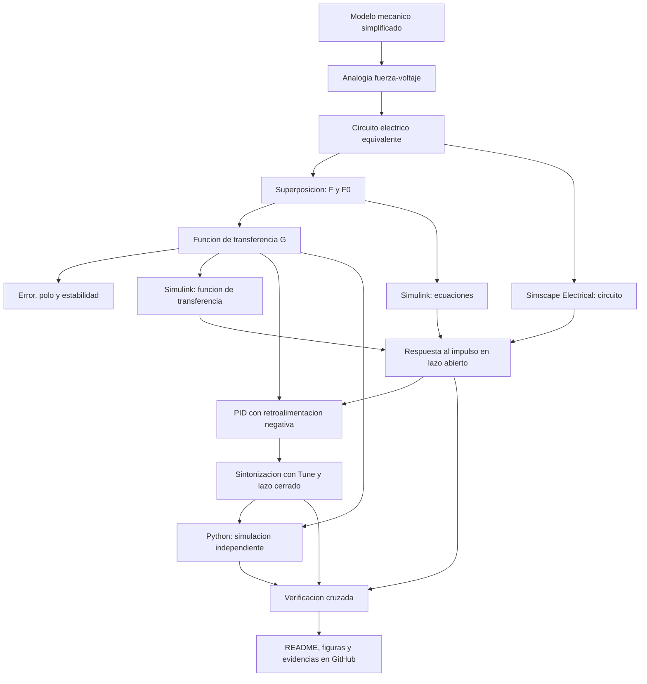

[](https://matlab.mathworks.com/open/github/v1?repo=l23212195-cpu/MSFP3)

# Práctica 5.5 — Modelado y control del sistema musculoesquelético

Repositorio académico de la asignatura **Modelado de Sistemas Fisiológicos**, correspondiente al programa de **Ingeniería Biomédica** del Tecnológico Nacional de México / Instituto Tecnológico de Tijuana. En esta práctica (Práctica #3 del curso, sección 5.5 del syllabus) se analiza un modelo mecánico simplificado del sistema musculoesquelético, se construye su circuito eléctrico equivalente mediante la analogía **fuerza–voltaje**, se compara la respuesta de un individuo sano (*control*) con un caso simulado de atrofia muscular (*caso*) y se diseña una estrategia de control *in silico* con un controlador PID.

**Docente:** Dr. Paul Antonio Valle Trujillo  
**Correo:** paul.valle@tectijuana.edu.mx  
**Departamento:** Ingeniería Eléctrica y Electrónica  
**Institución:** Tecnológico Nacional de México / Instituto Tecnológico de Tijuana  
**Asignatura:** Modelado de Sistemas Fisiológicos  
**Programa:** Ingeniería Biomédica  
**Estudiante:** Garcia Grijalava Armando · 23212195 · L23212195@tijuana.tecnm.mx

**Repositorio de la asignatura:** https://github.com/DrPaulValle/MSF-IBF1020  
**Sede:** Blvd. Alberto Limón Padilla s/n, Tijuana, C. P. 22454, B. C., México.

---

<a id="contenido"></a>
## Contenido

1. [Resumen](#resumen)
2. [Competencia y objetivos](#objetivos)
3. [Relación con el temario](#temario)
4. [Modelo mecánico y analogía electromecánica](#analogia)
5. [Formulación matemática](#modelo)
6. [Análisis de error y estabilidad](#analisis)
7. [Señal de entrada y condiciones de simulación](#senales)
8. [Implementación en MATLAB, Simulink y Simscape](#matlab)
9. [Control en lazo cerrado y sintonización PID](#pid)
10. [Reproducción en Python](#python)
11. [Resultados y verificación cruzada](#resultados)
12. [Diagrama biológico](#biologico)
13. [Flujo de trabajo](#flujo)
14. [Actividades del estudiante](#actividades)
15. [Estructura del repositorio](#estructura)
16. [Requisitos](#requisitos)
17. [Reproducibilidad y entregables](#reproducibilidad)
18. [Referencias](#referencias)

---

<a id="resumen"></a>
## Resumen

Los modelos mecánicos permiten representar de forma simplificada las propiedades viscoelásticas del sistema musculoesquelético mediante combinaciones de un elemento contráctil, resortes y amortiguadores. En esta práctica se parte del compartimento musculoesquelético propuesto por Khoo, formado por un generador de fuerza activo $F_0(t)$, un amortiguador viscoso $R$, un elemento elástico en serie $C_s$ y un elemento elástico en paralelo $C_p$.

El modelo mecánico se convierte a un circuito eléctrico equivalente con la analogía fuerza–voltaje. Como el circuito contiene dos fuentes de voltaje, $F(t)$ y $F_0(t)=\alpha F(t)$, se aplica el **principio de superposición** para obtener la función de transferencia entre la fuerza aplicada y la variable de salida. Se estudian el error en estado estacionario y la estabilidad, y se comparan dos conjuntos de parámetros: el individuo sano (**control**, $R=100\,\Omega$) y un caso simulado de **atrofia muscular** (**caso**, $R=10\,\mathrm{k}\Omega$), donde únicamente se incrementa la componente viscosa.

Posteriormente se implementan tres representaciones en MATLAB/Simulink/Simscape, se obtiene la respuesta al impulso en lazo abierto, se incorpora un **controlador PID** al caso usando como referencia la respuesta del control y se verifican los resultados con un cuaderno de MATLAB y con código en Python.

> **Alcance:** la práctica se desarrolla exclusivamente mediante experimentación *in silico*. La estrategia de control tiene propósitos académicos y de simulación y **no constituye una estrategia terapéutica** para el tratamiento de la atrofia muscular.

**Palabras clave:** sistema musculoesquelético; analogía fuerza–voltaje; atrofia muscular; superposición; controlador PID; MATLAB; Simulink; Simscape Electrical; Python; simulación *in silico*.

[Volver al contenido](#contenido)

---

<a id="objetivos"></a>
## Competencia y objetivos

### Competencia a desarrollar

Modelizar sistemas fisiológicos mediante analogías entre sistemas físicos, ecuaciones diferenciales y funciones de transferencia para analizar su comportamiento dinámico, y diseñar estrategias de control mediante técnicas de control clásico.

### Objetivo general

Analizar un modelo mecánico simplificado del sistema musculoesquelético, construir su circuito eléctrico equivalente, comparar la dinámica de un individuo sano con la de un caso simulado de atrofia muscular y diseñar un controlador PID *in silico* que reduzca la diferencia entre ambas respuestas.

### Objetivos específicos

- Identificar los elementos $F_0(t)$, $F(t)$, $R$, $C_p$, $C_s$, $x(t)$ y $x_1(t)$ y describir su función mecánica.
- Convertir el modelo mecánico en un circuito eléctrico equivalente con la analogía fuerza–voltaje.
- Formular las ecuaciones del sistema y obtener la función de transferencia mediante superposición y transformada de Laplace.
- Calcular el error en estado estacionario y analizar la estabilidad mediante los polos de control y caso.
- Implementar el modelo en Simulink (ecuaciones y función de transferencia) y en Simscape Electrical (circuito).
- Obtener la respuesta al impulso unitario de control y caso en $t\in[0,10]\,\mathrm{s}$.
- Sintonizar un controlador PID con la herramienta *Tune* y analizar la respuesta en lazo cerrado.
- Reproducir los resultados en un cuaderno de MATLAB y en Python y realizar la verificación cruzada.
- Elaborar un diagrama biológico que relacione el modelo con las estructuras musculoesqueléticas.
- Documentar el desarrollo en un repositorio de GitHub.

[Volver al contenido](#contenido)

---

<a id="temario"></a>
## Relación con el temario

| Unidad | Área | Contenidos aplicados |
|---|---|---|
| I | Sistemas de control retroalimentados | Diagramas de bloques, respuesta ante el impulso, análisis de error y estabilidad |
| II | Modelado matemático | Analogías electromecánicas, leyes de equilibrio y Kirchhoff, superposición y función de transferencia |
| III | Controladores | Diseño del PID y sintonización de ganancias |

El enfoque integra **Ingeniería de Control, Electrónica Analógica, Ciencias de la Computación y Fisiología** (asignatura IBF-1020).

[Volver al contenido](#contenido)

---

<a id="analogia"></a>
## Modelo mecánico y analogía electromecánica

### Elementos del modelo mecánico

| Elemento | Descripción | Interpretación fisiológica simplificada |
|---|---|---|
| $F_0(t)$ | Fuerza del elemento contráctil activo, con $F_0(t)=\alpha F(t)$ y $0<\alpha<1$ | Elemento contráctil muscular |
| $F(t)$ | Fuerza transmitida por el sistema tras considerar sus propiedades mecánicas | Fuerza generada |
| $R$ | Amortiguador viscoso | Viscosidad inherente al tejido |
| $C_s$ | Compliancia del elemento elástico en serie | Tendones |
| $C_p$ | Compliancia del elemento elástico en paralelo | Sarcolema y estructuras musculares pasivas |
| $x(t)$ | Desplazamiento total | Desplazamiento del sistema |
| $x_1(t)$ | Desplazamiento de $C_s$ | Deformación del elemento en serie |
| $x(t)-x_1(t)$ | Deformación del amortiguador | Velocidad relativa: $\frac{d}{dt}[x(t)-x_1(t)]$ |


### Analogía fuerza–voltaje

| Sistema mecánico | Sistema eléctrico equivalente |
|---|---|
| Fuerza $F(t)$ | Voltaje $V(t)$ |
| Velocidad $\dot{x}(t)$ | Corriente $I(t)$ |
| Desplazamiento $x(t)$ | Carga eléctrica $q(t)$ |
| Amortiguador | Resistencia $R$ |
| Compliancia mecánica | Capacitancia $C$ |
| Masa | Inductancia $L$ (no presente en este modelo) |

Los componentes mecánicos conectados en paralelo se convierten en elementos eléctricos en serie, y los conectados en serie, en elementos eléctricos en paralelo; por ello las topologías mecánica y eléctrica no coinciden.

### Circuito eléctrico equivalente

Del análisis de la transformación (ver [`Análisis_matemático_P3.pdf`](Análisis_matemático_P3.pdf)):

- La fuente $F_0(t)$ y el resistor $R$ (mecánicamente en paralelo) quedan **en serie**.
- Esa rama en serie queda **en paralelo** con $C_s$, porque comparten la misma fuerza (voltaje) y sus desplazamientos se suman: $x(t)=x_1(t)+x_2(t)$.
- El conjunto anterior queda **en serie** con $C_p$ y con la fuente $F(t)$, ya que ambas ramas comparten el mismo desplazamiento total $x(t)$.

La salida $F_s(t)$ corresponde al voltaje sobre $C_p$ (nodo entre la rama paralela y $C_p$); el desplazamiento se obtiene como carga: $x(t)=C_p\,F_s(t)$.


### Parámetros del circuito equivalente

| Parámetro | Control (individuo sano) | Caso (atrofia muscular) |
|---|---:|---:|
| $F(t)$ | $1\,\mathrm{V}$ | $1\,\mathrm{V}$ |
| $\alpha$ | $0.25$ | $0.25$ |
| $C_s$ | $10\,\mu\mathrm{F}$ | $10\,\mu\mathrm{F}$ |
| $C_p$ | $100\,\mu\mathrm{F}$ | $100\,\mu\mathrm{F}$ |
| $R$ | $100\,\Omega$ | $10\,\mathrm{k}\Omega$ |

La diferencia entre control y caso se representa **únicamente** mediante el incremento de $R$, que modifica la componente viscosa del modelo y produce una respuesta mecánica distinta.

[Volver al contenido](#contenido)

---

<a id="modelo"></a>
## Formulación matemática

Como el circuito contiene dos fuentes, $F(t)$ y $F_0(t)=\alpha F(t)$, se aplica el principio de superposición.

### 1. Circuito 1: se apaga $F_0(t)$

Con $F_0$ apagada, la fuente $F_0$ se sustituye por un cortocircuito. Para la salida parcial $F_{s1}(t)$ se cumple

$$
\dot{x}(t)=\dot{x}_1(t)+\dot{x}_2(t),
$$

con las relaciones constitutivas

$$
\dot{x}(t)=C_p\frac{dF_{s1}(t)}{dt},\qquad
\dot{x}_1(t)=C_s\frac{d\left[F(t)-F_{s1}(t)\right]}{dt},\qquad
\dot{x}_2(t)=\frac{F(t)-F_{s1}(t)}{R}.
$$

Sustituyendo,

$$
C_p\frac{dF_{s1}(t)}{dt}=C_s\frac{d\left[F(t)-F_{s1}(t)\right]}{dt}+\frac{F(t)-F_{s1}(t)}{R}.
$$

Con la transformada de Laplace y condiciones iniciales nulas:

$$
F_{s1}(s)=\frac{RC_s s+1}{R(C_p+C_s)s+1}\,F(s).
$$

### 2. Circuito 2: se apaga $F(t)$

Con $F$ apagada, $C_p$ y $C_s$ quedan en paralelo y se reducen a $C_p+C_s$, en serie con $R$ y la fuente $-F_0(t)=-\alpha F(t)$. La función parcial resulta

$$
F_{s2}(s)=-\frac{\alpha}{R(C_p+C_s)s+1}\,F(s).
$$

### 3. Función de transferencia

Por superposición, $F_s(s)=F_{s1}(s)+F_{s2}(s)$:

$$
\boxed{G(s)=\frac{F_s(s)}{F(s)}=\frac{RC_s\,s+1-\alpha}{R(C_p+C_s)\,s+1}.}
$$

Es un sistema de **primer orden** con un cero. El orden coincide con el número de elementos independientes de almacenamiento de energía tras la reducción del circuito ($C_p+C_s$ equivalentes en un único capacitor).

Si la variable de salida es el desplazamiento (carga), se cumple $X(s)=C_p\,F_s(s)$, por lo que

$$
\frac{X(s)}{F(s)}=C_p\,G(s)=\frac{C_p\left(RC_s\,s+1-\alpha\right)}{R(C_p+C_s)\,s+1}.
$$

> La forma anterior difiere de $G(s)$ solo por el factor constante $C_p$; la dinámica, los polos y el cero son los mismos.

### 4. Funciones de transferencia numéricas

Con $\tau=R(C_p+C_s)$:

| Caso | $R$ | $\tau$ | $G(s)$ |
|---|---:|---:|---|
| Control | $100\,\Omega$ | $0.011\,\mathrm{s}$ | $\dfrac{10^{-3}s+0.75}{0.011\,s+1}$ |
| Caso | $10\,\mathrm{k}\Omega$ | $1.1\,\mathrm{s}$ | $\dfrac{0.1\,s+0.75}{1.1\,s+1}$ |

> Valores obtenidos sustituyendo en la expresión simbólica; verifica que coincidan con los de MATLAB (`tf`, `pole`, `zero`) y Python.

### 5. Respuesta al impulso (referencia analítica)

Como $G(s)$ tiene el mismo grado en numerador y denominador, se puede escribir

$$
G(s)=D+\frac{G(0)-D}{\tau s+1},\qquad D=\frac{C_s}{C_p+C_s}=\frac{1}{11}\approx0.0909,\quad G(0)=1-\alpha=0.75,
$$

y la respuesta al impulso unitario contiene un término instantáneo:

$$
g(t)=D\,\delta(t)+\frac{G(0)-D}{\tau}\,e^{-t/\tau},\qquad G(0)-D\approx0.6591.
$$

| Caso | Amplitud inicial del término exponencial | Constante de tiempo |
|---|---:|---:|
| Control | $\approx59.9$ | $0.011\,\mathrm{s}$ |
| Caso | $\approx0.599$ | $1.1\,\mathrm{s}$ |

El **área** del término exponencial es la misma en ambos casos; el incremento de $R$ únicamente lo hace más lento y de menor amplitud.

> **Nota numérica:** el término $D\,\delta(t)$ no se representa por completo con un impulso discretizado. En simulación el impulso se aproxima con un pulso estrecho de área unitaria y, en algunas herramientas (por ejemplo, funciones de respuesta al impulso de Python), el término instantáneo puede omitirse. Esto debe considerarse al comparar plataformas.

[Volver al contenido](#contenido)

---

<a id="analisis"></a>
## Análisis de error y estabilidad

### 1. Error en estado estacionario

Para una entrada escalón unitario, $F(s)=1/s$, y con la definición de error entre entrada y salida:

$$
e_{ss}=\lim_{s\to0}sF(s)\left[1-G(s)\right]=1-(1-\alpha)=\alpha.
$$

$$
\boxed{e_{ss}=\alpha=0.25}
$$

El valor final $G(0)=1-\alpha$ **no depende de $R$**; por tanto, el error en estado estacionario es el mismo en control y caso, y la diferencia entre sus respuestas finales ante un escalón tiende a cero. El incremento de $R$ modifica solamente el comportamiento **transitorio**. Para la entrada impulso, la respuesta de ambos modelos tiende a cero.

### 2. Polo, cero y estabilidad

El polo satisface $R(C_p+C_s)s+1=0$:

$$
\lambda=-\frac{1}{R(C_p+C_s)}\in\mathbb{R}^-,\qquad
z=-\frac{1-\alpha}{RC_s}.
$$

| Caso | Polo $\lambda$ (rad/s) | Cero $z$ (rad/s) | Constante de tiempo | Estabilidad |
|---|---:|---:|---:|---|
| Control | $-90.91$ | $-750$ | $0.011\,\mathrm{s}$ | Estable |
| Caso | $-0.909$ | $-7.5$ | $1.1\,\mathrm{s}$ | Estable |

Ambos sistemas son estables, pues el polo es real y negativo. En el caso de atrofia el polo se desplaza hacia el origen: aumenta el amortiguamiento equivalente (mayor $\tau$) y la respuesta es notablemente más lenta.


### 3. Predicción previa

Antes de ejecutar las simulaciones, elaborar un bosquejo cualitativo de las respuestas de control y caso, y compararlo después con los resultados computacionales.

#### Ejemplo mínimo de verificación en MATLAB

```matlab
alpha = 0.25;
Cs = 10e-6;  Cp = 100e-6;      % F

R = 100;                        % ohm (control)
Gc = tf([R*Cs, 1-alpha],[R*(Cp+Cs), 1]);

R = 10e3;                       % ohm (caso)
Gp = tf([R*Cs, 1-alpha],[R*(Cp+Cs), 1]);

pole(Gc), pole(Gp)
zero(Gc), zero(Gp)
```

Este código es ilustrativo y no sustituye los archivos del estudiante.

[Volver al contenido](#contenido)

---

<a id="senales"></a>
## Señal de entrada y condiciones de simulación

| Elemento | Definición |
|---|---|
| Entrada | Impulso unitario (aproximado por un pulso estrecho de área unitaria en las simulaciones numéricas) |
| Intervalo | $t\in[0,10]\,\mathrm{s}$ |
| Amplitud de $F(t)$ en el circuito | $1\,\mathrm{V}$ |
| Condiciones iniciales | Nulas |

[Definir aquí el ancho del pulso, el paso máximo y el solver empleados en Simulink.]

La **misma entrada** y las mismas condiciones se aplican a control, caso y sistema controlado, y en todas las representaciones.

[Volver al contenido](#contenido)

---

<a id="matlab"></a>
## Implementación en MATLAB, Simulink y Simscape

Se construyen tres representaciones para control y caso:

| Implementación | Descripción | Aspecto por verificar |
|---|---|---|
| Ecuaciones del sistema, Simulink | Bloques que implementan las ecuaciones de la sección de formulación matemática | Consistencia con las relaciones constitutivas |
| Función de transferencia, Simulink | Bloque *Transfer Fcn* con $G(s)$ | Respuesta entrada–salida |
| Circuito equivalente, Simscape Electrical | Fuentes de voltaje, $R$, $C_s$ y $C_p$ con la topología obtenida | Concordancia con las representaciones matemáticas |

En Simscape la salida $F_s(t)$ se mide como el voltaje sobre $C_p$; si se desea el desplazamiento se multiplica por $C_p$ (o se integra la corriente). La fuente $F_0(t)=\alpha F(t)$ puede implementarse como fuente de voltaje controlada con ganancia $\alpha$.

### Ejecución desde el cuaderno MATLAB

El cuaderno ejecuta el modelo de Simulink y almacena en el *Workspace* las respuestas de:

1. **Control** (individuo sano).
2. **Caso en lazo abierto**.
3. **Caso con controlador PID**.

Una función del cuaderno debe: (a) graficar las respuestas, (b) identificar variables y unidades, (c) comparar control, caso y sistema controlado, y (d) guardar las figuras en PDF.

[Volver al contenido](#contenido)

---

<a id="pid"></a>
## Control en lazo cerrado y sintonización PID

### 1. Esquema de control

De acuerdo con la Figura 5.4 de la guía, la misma entrada $V_e(t)$ se aplica al individuo sano (referencia) y al paciente (caso). El controlador PID se incorpora al modelo del caso, con retroalimentación negativa. La señal de error es

$$
e(t)=x_{control}(t)-x_{PID}(t),
$$

donde $x_{PID}(t)$ es la salida del caso con controlador. Con $K(s)=k_P+\dfrac{k_I}{s}+k_Ds$, la función de lazo cerrado respecto a la referencia $x_{control}$ es

$$
T(s)=\frac{K(s)G_{caso}(s)}{1+K(s)G_{caso}(s)}.
$$

> En el bloque *PID Controller* de Simulink debe revisarse la configuración de la acción derivativa (filtro) y la posible aparición de lazos algebraicos, dado que $G(s)$ tiene transmisión directa ($D\neq0$).

### 2. Sintonización

Se utiliza la herramienta **Tune** del bloque *PID Controller* para obtener $k_P$, $k_I$ y $k_D$ buscando una respuesta **estable** y una **reducción del error** entre la salida del caso y la respuesta de referencia. La guía no establece criterios numéricos como tiempo de establecimiento o sobreimpulso; se recomienda reportar de forma explícita un indicador del error (por ejemplo, el error máximo o la integral del error cuadrático) para respaldar la mejora.

| Ganancia | Valor |
|---|---|
| $k_P$ | [valor] |
| $k_I$ | [valor] |
| $k_D$ | [valor] |


[Volver al contenido](#contenido)

---

<a id="python"></a>
## Reproducción en Python

El código en Visual Studio Code debe:

1. Definir las funciones de transferencia de control y caso con los parámetros de la tabla.
2. Calcular polos y ceros.
3. Obtener la respuesta al impulso con las mismas condiciones usadas en MATLAB/Simulink.
4. Incorporar las ganancias $k_P$, $k_I$ y $k_D$ obtenidas con *Tune*.
5. Construir el sistema en lazo cerrado del caso con retroalimentación respecto a la referencia del control.
6. Generar y guardar las figuras para compararlas con las de MATLAB/Simulink.

Las bibliotecas de Python deben verificarse en los módulos importados por el archivo `.py` del estudiante. Debe tenerse en cuenta el comentario sobre el término instantáneo $D\,\delta(t)$ al comparar respuestas.

[Volver al contenido](#contenido)

---

<a id="resultados"></a>
## Resultados y verificación cruzada

Convención de figuras sugerida: control (referencia), caso en lazo abierto y caso con PID en una misma gráfica.

### Respuesta en lazo abierto

[Insertar figura y describir la comparación entre control y caso: amplitud, rapidez y efecto del incremento de $R$.]


### Respuesta en lazo cerrado

Comparación de $x_{control}(t)$, $x_{caso}(t)$ y $x_{PID}(t)$.


[Analizar el efecto del controlador sobre amplitud, velocidad de respuesta, amortiguamiento y diferencia entre caso y control.]

### Verificación cruzada

| Implementación | Archivo / figura | Observaciones |
|---|---|---|
| Ecuaciones en Simulink | [archivo] | [comentario] |
| Función de transferencia en Simulink | [archivo] | [comentario] |
| Circuito en Simscape Electrical | [archivo] | [comentario] |
| Cuaderno MATLAB | [archivo] | [comentario] |
| Python | [archivo] | [comentario] |

| Comparación | Diferencia máxima | Posible causa |
|---|---|---|
| Ecuaciones vs. función de transferencia | [valor] | [comentario] |
| Simulink vs. Simscape | [valor] | [comentario] |
| MATLAB vs. Python | [valor] | [comentario] |

### Aspectos para discutir

- Coincidencia entre las representaciones por ecuaciones, función de transferencia y circuito.
- Efecto del incremento de $R$ sobre el polo, la constante de tiempo y la respuesta.
- Efecto del PID sobre el seguimiento de la referencia y el error.
- Consistencia entre MATLAB y Python, y tratamiento del impulso.
- Limitaciones del modelo mecánico de parámetros concentrados y de la analogía.

**Resultados del estudiante:** agregar las ganancias sintonizadas, las figuras, las capturas y un comentario interpretativo propio. No se incluyen ganancias ni resultados de simulación ficticios.

[Volver al contenido](#contenido)

---

<a id="biologico"></a>
## Diagrama biológico

Diagrama elaborado en BioRender (o herramienta equivalente) que relaciona los elementos del modelo con las estructuras musculoesqueléticas. Debe identificar, como mínimo: elemento contráctil muscular, estructuras elásticas musculares, tendón, desplazamiento, fuerza generada y elementos de comportamiento viscoso y elástico.


| Estructura biológica | Elemento mecánico | Equivalente eléctrico |
|---|---|---|
| Elemento contráctil | $F_0(t)$ | Fuente de voltaje $\alpha F(t)$ |
| Viscosidad del tejido | Amortiguador $R$ | Resistor $R$ |
| Tendón | Elemento en serie $C_s$ | Capacitor $C_s$ |
| Sarcolema / estructuras pasivas | Elemento en paralelo $C_p$ | Capacitor $C_p$ |
| Fuerza generada | $F(t)$ | Voltaje $V(t)$ |
| Desplazamiento | $x(t)$ | Carga $q(t)$ |

> Asignaciones fisiológicas simplificadas, tal como las plantea la guía; confirmar con el diagrama final.

[Volver al contenido](#contenido)

---

<a id="flujo"></a>
## Flujo de trabajo



[Volver al contenido](#contenido)

---

<a id="actividades"></a>
## Actividades del estudiante

### Etapa 1. Modelado y análisis

- [ ] Identificar los elementos y variables del modelo mecánico.
- [ ] Construir el circuito equivalente con la analogía fuerza–voltaje.
- [ ] Aplicar superposición y obtener $G(s)$ para control y caso.
- [ ] Calcular el error en estado estacionario.
- [ ] Calcular polo y cero, y analizar la estabilidad.
- [ ] Elaborar el bosquejo previo de la respuesta.

### Etapa 2. Simulación en lazo abierto

- [ ] Implementar el modelo por ecuaciones en Simulink.
- [ ] Implementar la función de transferencia en Simulink.
- [ ] Implementar el circuito en Simscape Electrical.
- [ ] Obtener la respuesta al impulso en $t\in[0,10]\,\mathrm{s}$ y comparar control y caso.

### Etapa 3. Control

- [ ] Construir el sistema de la Figura 5.4 con el bloque PID en el caso.
- [ ] Sintonizar $k_P$, $k_I$ y $k_D$ con *Tune* y guardar la evidencia.
- [ ] Obtener la respuesta en lazo cerrado y analizarla.

### Etapa 4. Verificación y documentación

- [ ] Desarrollar el cuaderno de MATLAB con la función de graficación (figuras en PDF).
- [ ] Implementar y ejecutar el código en Python.
- [ ] Realizar la verificación cruzada de las cinco implementaciones.
- [ ] Elaborar el diagrama biológico.
- [ ] Publicar el repositorio con `README.md` y `CITATION.cff`.

[Volver al contenido](#contenido)

---

<a id="estructura"></a>
## Estructura del repositorio

Organización **sugerida** (los nombres de archivos del estudiante no están especificados en la guía):

```text
.
├── README.md
├── CITATION.cff
├── Análisis_matemático_P3.pdf        # Análisis del modelo, analogía y función de transferencia
├── Apellido_NoControl.mlx            # Cuaderno MATLAB
├── Apellido_NoControl.pdf            # Exportación del cuaderno
├── musculoesqueletico.slx            # Modelos Simulink
├── musculoesqueletico_simscape.slx   # Circuito en Simscape Electrical
├── musculoesqueletico.py             # Código Python
├── figuras/
│   ├── modelo_mecanico.png
│   ├── circuito_equivalente.png
│   ├── polos_ceros.png
│   ├── tune_pid.png
│   ├── diagrama_biologico.png
│   ├── lazo_abierto_matlab.pdf
│   ├── lazo_cerrado_matlab.pdf
│   ├── lazo_abierto_python.pdf
│   └── lazo_cerrado_python.pdf
└── evidencias/                       # Capturas de las simulaciones
```

Si se usan otros nombres o carpetas, actualizar las rutas de este README.

[Volver al contenido](#contenido)

---

<a id="requisitos"></a>
## Requisitos

- **MATLAB** y **Simulink**.
- **Simscape Electrical** para el circuito equivalente.
- Herramientas de sintonización PID de Simulink (*Tune*).
- **Control System Toolbox** para `tf`, `pole` y `zero` (ejemplo ilustrativo).
- **Python** y **Visual Studio Code**, con las bibliotecas importadas por el código.
- **Git y GitHub**.
- BioRender o herramienta equivalente para el diagrama biológico.

Las versiones mínimas no se especifican en la guía.

[Volver al contenido](#contenido)

---

<a id="reproducibilidad"></a>
## Reproducibilidad y entregables

### Secuencia de reproducción

1. Verificar la topología del circuito y los valores de $R$, $C_s$, $C_p$ y $\alpha$.
2. Revisar el análisis matemático y completar polos, cero y error.
3. Ejecutar los modelos de Simulink y Simscape con el impulso definido.
4. Sintonizar el PID y registrar las ganancias.
5. Ejecutar el cuaderno de MATLAB y exportar las figuras en PDF.
6. Ejecutar el código de Python con las mismas ganancias y condiciones.
7. Comparar resultados y explicar diferencias.
8. Completar este README y publicar el repositorio.

### Resultados mínimos esperados

| Entregable | Evidencia |
|---|---|
| Análisis del modelo mecánico | Descripción de elementos y restricciones |
| Analogía electromecánica | Circuito equivalente |
| Análisis matemático | $G(s)$, error, polo y cero |
| Simulaciones | Archivos `.slx` y respuestas de control, caso y caso con PID |
| Sintonización | $k_P$, $k_I$, $k_D$ y evidencia de *Tune* |
| MATLAB | Cuaderno `.mlx` y figuras en PDF |
| Python | Código `.py` y figuras |
| Diagrama biológico | Elementos mínimos solicitados |
| Documentación | `README.md` y `CITATION.cff` |

### Criterios de presentación académica

Distinguir entre resultados reproducidos, resultados propios y modificaciones realizadas. La ejecución de scripts y la generación de figuras no sustituyen la discusión del comportamiento fisiológico, matemático y eléctrico.

[Volver al contenido](#contenido)

---

<a id="referencias"></a>
## Referencias

[1] M. C. Khoo, *Physiological Control Systems: Analysis, Simulation, and Estimation*, 2nd ed., IEEE Press, 2018.

[2] F. C. Hoppensteadt y C. S. Peskin, *Modeling and Simulation in Medicine and the Life Sciences*, Springer.

[3] J. E. Hall, *Guyton and Hall Textbook of Medical Physiology*, 14th ed., Elsevier, 2021.

[4] K. Ogata, *Ingeniería de Control Moderna*, 5.ª ed., Pearson Educación, 2010.

[5] N. S. Nise, *Control Systems Engineering*, 8th ed., John Wiley & Sons, 2020.

[6] P. A. Valle, *Syllabus para Modelado de Sistemas Fisiológicos*, Tecnológico Nacional de México / Instituto Tecnológico de Tijuana, Tijuana, B. C., México, 2026. Disponible en: https://biomath.xyz/course/

[7] Tecnológico Nacional de México, *Programa de estudio de la asignatura Modelado de Sistemas Fisiológicos, IBF-1020*.

---

## Uso académico

Este repositorio se utiliza como evidencia de una práctica de **Modelado de Sistemas Fisiológicos**. La estrategia de control tiene fines exclusivamente académicos y de simulación, y no constituye una recomendación terapéutica. Cualquier cambio de parámetros, estructura del controlador o procedimiento debe identificarse y justificarse.
