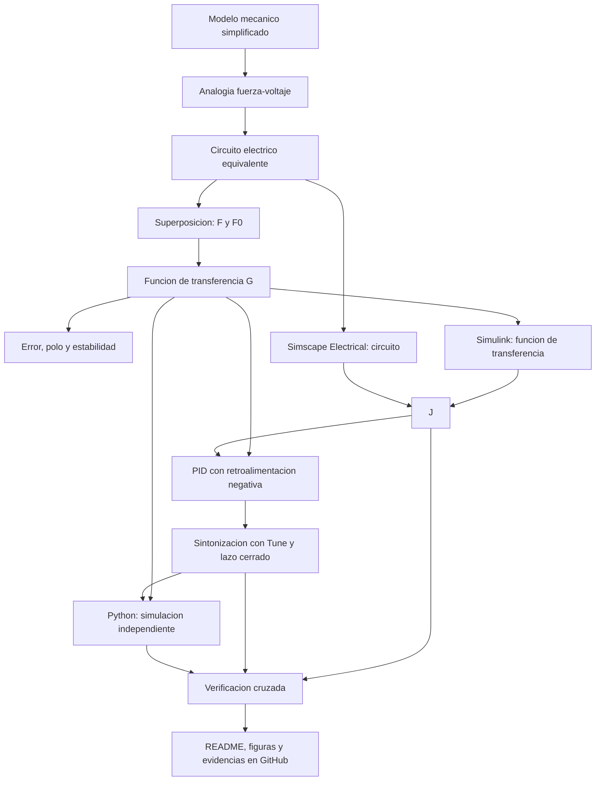

[](https://matlab.mathworks.com/open/github/v1?repo=l23212195-cpu/MSFP3)

# Práctica 5.5 — Modelado y control del sistema musculoesquelético

Repositorio académico de la asignatura **Modelado de Sistemas Fisiológicos**, correspondiente al programa de **Ingeniería Biomédica** del Tecnológico Nacional de México / Instituto Tecnológico de Tijuana. En esta práctica (Práctica #3 del curso, sección 5.5 del syllabus) se analiza un modelo mecánico simplificado del sistema musculoesquelético, se construye su circuito eléctrico equivalente mediante la analogía **fuerza–voltaje**, se compara la respuesta de un individuo sano (*control*) con un caso simulado de atrofia muscular (*caso*) y se diseña una estrategia de control *in silico* con un controlador PID.

**Docente:** Dr. Paul Antonio Valle Trujillo  
**Correo:** paul.valle@tectijuana.edu.mx  
**Departamento:** Ingeniería Eléctrica y Electrónica  
**Institución:** Tecnológico Nacional de México / Instituto Tecnológico de Tijuana  
**Asignatura:** Modelado de Sistemas Fisiológicos  
**Programa:** Ingeniería Biomédica  
**Estudiante:** Garcia Grijalva Armando · 23212195 · L23212195@tijuana.tecnm.mx

**Repositorio de la asignatura:** https://github.com/DrPaulValle/MSF-IBF1020  
**Sede:** Blvd. Alberto Limón Padilla s/n, Tijuana, C. P. 22454, B. C., México.

---

<a id="contenido"></a>
## Contenido

1. [Resumen](#resumen)
2. [Competencia y objetivos](#objetivos)
3. [Relación con el temario](#temario)
4. [Modelo mecánico y analogía electromecánica](#analogia)
5. [Formulación matemática](#modelo)
6. [Análisis de error y estabilidad](#analisis)
7. [Señal de entrada y condiciones de simulación](#senales)
8. [Implementación en MATLAB, Simulink y Simscape](#matlab)
9. [Control en lazo cerrado y sintonización PID](#pid)
10. [Reproducción en Python](#python)
11. [Resultados y verificación cruzada](#resultados)
12. [Discusión](#discusion)
13. [Conclusiones](#conclusiones)
14. [Diagrama biológico](#biologico)
15. [Flujo de trabajo](#flujo)
16. [Actividades del estudiante](#actividades)
17. [Estructura del repositorio](#estructura)
18. [Requisitos](#requisitos)
19. [Reproducibilidad y entregables](#reproducibilidad)
20. [Referencias](#referencias)

---

<a id="resumen"></a>
## Resumen

Los modelos mecánicos permiten representar de forma simplificada las propiedades viscoelásticas del sistema musculoesquelético mediante combinaciones de un elemento contráctil, resortes y amortiguadores. En esta práctica se parte del compartimento musculoesquelético propuesto por Khoo, formado por un generador de fuerza activo $F_0(t)$, un amortiguador viscoso $R$, un elemento elástico en serie $C_s$ y un elemento elástico en paralelo $C_p$.

El modelo mecánico se convierte a un circuito eléctrico equivalente con la analogía fuerza–voltaje. Como el circuito contiene dos fuentes de voltaje, $F(t)$ y $F_0(t)=\alpha F(t)$, se aplica el **principio de superposición** para obtener la función de transferencia entre la fuerza aplicada y la variable de salida. Se estudian el error en estado estacionario y la estabilidad, y se comparan dos conjuntos de parámetros: el individuo sano (**control**, $R=100\,\Omega$) y un caso simulado de **atrofia muscular** (**caso**, $R=10\,\mathrm{k}\Omega$), donde únicamente se incrementa la componente viscosa.

Posteriormente se implementan dos representaciones en MATLAB/Simulink/Simscape (función de transferencia y circuito equivalente), se obtiene la respuesta al impulso en lazo abierto, se incorpora un **controlador PID** al caso usando como referencia la respuesta del control y se verifican los resultados con un cuaderno de MATLAB y con código en Python.

> **Alcance:** la práctica se desarrolla exclusivamente mediante experimentación *in silico*. La estrategia de control tiene propósitos académicos y de simulación y **no constituye una estrategia terapéutica** para el tratamiento de la atrofia muscular.

**Palabras clave:** sistema musculoesquelético; analogía fuerza–voltaje; atrofia muscular; superposición; controlador PID; MATLAB; Simulink; Simscape Electrical; Python; simulación *in silico*.

[Volver al contenido](#contenido)

---

<a id="objetivos"></a>
## Competencia y objetivos

### Competencia a desarrollar

Modelizar sistemas fisiológicos mediante analogías entre sistemas físicos, ecuaciones diferenciales y funciones de transferencia para analizar su comportamiento dinámico, y diseñar estrategias de control mediante técnicas de control clásico.

### Objetivo general

Analizar un modelo mecánico simplificado del sistema musculoesquelético, construir su circuito eléctrico equivalente, comparar la dinámica de un individuo sano con la de un caso simulado de atrofia muscular y diseñar un controlador PID *in silico* que reduzca la diferencia entre ambas respuestas.

### Objetivos específicos

- Identificar los elementos $F_0(t)$, $F(t)$, $R$, $C_p$, $C_s$, $x(t)$ y $x_1(t)$ y describir su función mecánica.
- Convertir el modelo mecánico en un circuito eléctrico equivalente con la analogía fuerza–voltaje.
- Formular las ecuaciones del sistema y obtener la función de transferencia mediante superposición y transformada de Laplace.
- Calcular el error en estado estacionario y analizar la estabilidad mediante los polos de control y caso.
- Implementar el modelo en Simulink mediante su función de transferencia y mediante el circuito equivalente en Simscape Electrical.
- Obtener la respuesta al impulso unitario de control y caso en $t\in[0,10]\,\mathrm{s}$.
- Sintonizar un controlador PID con la herramienta *Tune* y analizar la respuesta en lazo cerrado.
- Reproducir los resultados en un cuaderno de MATLAB y en Python y realizar la verificación cruzada.
- Elaborar un diagrama biológico que relacione el modelo con las estructuras musculoesqueléticas.
- Documentar el desarrollo en un repositorio de GitHub.

[Volver al contenido](#contenido)

---

<a id="temario"></a>
## Relación con el temario

| Unidad | Área | Contenidos aplicados |
|---|---|---|
| I | Sistemas de control retroalimentados | Diagramas de bloques, respuesta ante el impulso, análisis de error y estabilidad |
| II | Modelado matemático | Analogías electromecánicas, leyes de equilibrio y Kirchhoff, superposición y función de transferencia |
| III | Controladores | Diseño del PID y sintonización de ganancias |

El enfoque integra **Ingeniería de Control, Electrónica Analógica, Ciencias de la Computación y Fisiología** (asignatura IBF-1020).

[Volver al contenido](#contenido)

---

<a id="analogia"></a>
## Modelo mecánico y analogía electromecánica

### Elementos del modelo mecánico

| Elemento | Descripción | Interpretación fisiológica simplificada |
|---|---|---|
| $F_0(t)$ | Fuerza del elemento contráctil activo, con $F_0(t)=\alpha F(t)$ y $0<\alpha<1$ | Elemento contráctil muscular |
| $F(t)$ | Fuerza transmitida por el sistema tras considerar sus propiedades mecánicas | Fuerza generada |
| $R$ | Amortiguador viscoso | Viscosidad inherente al tejido |
| $C_s$ | Compliancia del elemento elástico en serie | Tendones |
| $C_p$ | Compliancia del elemento elástico en paralelo | Sarcolema, estructuras musculares pasivas y tejido adiposo |
| $x(t)$ | Desplazamiento total | Desplazamiento del sistema |
| $x_1(t)$ | Desplazamiento de $C_s$ | Deformación del elemento en serie |
| $x(t)-x_1(t)$ | Deformación del amortiguador | Velocidad relativa: $\frac{d}{dt}[x(t)-x_1(t)]$ |

*El modelo mecánico (Figura 5.3 de la guía) se muestra en la esquina superior izquierda del [diagrama biológico](#biologico) y de los subsistemas de Simulink.*

### Analogía fuerza–voltaje

| Sistema mecánico | Sistema eléctrico equivalente |
|---|---|
| Fuerza $F(t)$ | Voltaje $V(t)$ |
| Velocidad $\dot{x}(t)$ | Corriente $I(t)$ |
| Desplazamiento $x(t)$ | Carga eléctrica $q(t)$ |
| Amortiguador | Resistencia $R$ |
| Compliancia mecánica | Capacitancia $C$ |
| Masa | Inductancia $L$ (no presente en este modelo) |

Los componentes mecánicos conectados en paralelo se convierten en elementos eléctricos en serie, y los conectados en serie, en elementos eléctricos en paralelo; por ello las topologías mecánica y eléctrica no coinciden.

### Circuito eléctrico equivalente

Del análisis de la transformación:

- La fuente $F_0(t)$ y el resistor $R$ (mecánicamente en paralelo) quedan **en serie**.
- Esa rama en serie queda **en paralelo** con $C_s$, porque comparten la misma fuerza (voltaje) y sus desplazamientos se suman: $x(t)=x_1(t)+x_2(t)$.
- El conjunto anterior queda **en serie** con $C_p$ y con la fuente $F(t)$, ya que ambas ramas comparten el mismo desplazamiento total $x(t)$.

La salida $F_s(t)$ corresponde al voltaje sobre $C_p$ (nodo entre la rama paralela y $C_p$); el desplazamiento se obtiene como carga: $x(t)=C_p\,F_s(t)$.

### Parámetros del circuito equivalente

| Parámetro | Control (individuo sano) | Caso (atrofia muscular) |
|---|---:|---:|
| $F(t)$ | $1\,\mathrm{V}$ | $1\,\mathrm{V}$ |
| $\alpha$ | $0.25$ | $0.25$ |
| $C_s$ | $10\,\mu\mathrm{F}$ | $10\,\mu\mathrm{F}$ |
| $C_p$ | $100\,\mu\mathrm{F}$ | $100\,\mu\mathrm{F}$ |
| $R$ | $100\,\Omega$ | $10\,\mathrm{k}\Omega$ |

La diferencia entre control y caso se representa **únicamente** mediante el incremento de $R$, que modifica la componente viscosa del modelo y produce una respuesta mecánica distinta.

[Volver al contenido](#contenido)

---

<a id="modelo"></a>
## Formulación matemática

Como el circuito contiene dos fuentes, $F(t)$ y $F_0(t)=\alpha F(t)$, se aplica el principio de superposición.

### 1. Circuito 1: se apaga $F_0(t)$

Con $F_0$ apagada, la fuente $F_0$ se sustituye por un cortocircuito. Para la salida parcial $F_{s1}(t)$ se cumple

$$
\dot{x}(t)=\dot{x}_1(t)+\dot{x}_2(t),
$$

con las relaciones constitutivas

$$
\dot{x}(t)=C_p\frac{dF_{s1}(t)}{dt},\qquad
\dot{x}_1(t)=C_s\frac{d\left[F(t)-F_{s1}(t)\right]}{dt},\qquad
\dot{x}_2(t)=\frac{F(t)-F_{s1}(t)}{R}.
$$

Sustituyendo,

$$
C_p\frac{dF_{s1}(t)}{dt}=C_s\frac{d\left[F(t)-F_{s1}(t)\right]}{dt}+\frac{F(t)-F_{s1}(t)}{R}.
$$

Con la transformada de Laplace y condiciones iniciales nulas:

$$
F_{s1}(s)=\frac{RC_s s+1}{R(C_p+C_s)s+1}\,F(s).
$$

### 2. Circuito 2: se apaga $F(t)$

Con $F$ apagada, $C_p$ y $C_s$ quedan en paralelo y se reducen a $C_p+C_s$, en serie con $R$ y la fuente $-F_0(t)=-\alpha F(t)$. La función parcial resulta

$$
F_{s2}(s)=-\frac{\alpha}{R(C_p+C_s)s+1}\,F(s).
$$

### 3. Función de transferencia

Por superposición, $F_s(s)=F_{s1}(s)+F_{s2}(s)$:

$$
\boxed{G(s)=\frac{F_s(s)}{F(s)}=\frac{RC_s\,s+1-\alpha}{R(C_p+C_s)\,s+1}.}
$$

Es un sistema de **primer orden** con un cero. El orden coincide con el número de elementos independientes de almacenamiento de energía tras la reducción del circuito ($C_p+C_s$ equivalentes en un único capacitor).

Si la variable de salida es el desplazamiento (carga), se cumple $X(s)=C_p\,F_s(s)$, por lo que

$$
\frac{X(s)}{F(s)}=C_p\,G(s)=\frac{C_p\left(RC_s\,s+1-\alpha\right)}{R(C_p+C_s)\,s+1}.
$$

> La forma anterior difiere de $G(s)$ solo por el factor constante $C_p$; la dinámica, los polos y el cero son los mismos.

### 4. Funciones de transferencia numéricas

Con $\tau=R(C_p+C_s)$:

| Caso | $R$ | $\tau$ | $G(s)$ |
|---|---:|---:|---|
| Control | $100\,\Omega$ | $0.011\,\mathrm{s}$ | $\dfrac{10^{-3}s+0.75}{0.011\,s+1}$ |
| Caso | $10\,\mathrm{k}\Omega$ | $1.1\,\mathrm{s}$ | $\dfrac{0.1\,s+0.75}{1.1\,s+1}$ |

> Valores obtenidos sustituyendo en la expresión simbólica; verifica que coincidan con los de MATLAB (`tf`, `pole`, `zero`) y Python.

### 5. Respuesta al impulso (referencia analítica)

Como $G(s)$ tiene el mismo grado en numerador y denominador, se puede escribir

$$
G(s)=D+\frac{G(0)-D}{\tau s+1},\qquad D=\frac{C_s}{C_p+C_s}=\frac{1}{11}\approx0.0909,\quad G(0)=1-\alpha=0.75,
$$

y la respuesta al impulso unitario contiene un término instantáneo:

$$
g(t)=D\,\delta(t)+\frac{G(0)-D}{\tau}\,e^{-t/\tau},\qquad G(0)-D\approx0.6591.
$$

| Caso | Amplitud inicial del término exponencial | Constante de tiempo |
|---|---:|---:|
| Control | $\approx59.9$ | $0.011\,\mathrm{s}$ |
| Caso | $\approx0.599$ | $1.1\,\mathrm{s}$ |

El **área** del término exponencial es la misma en ambos casos; el incremento de $R$ únicamente lo hace más lento y de menor amplitud.

> **Nota numérica:** el término $D\,\delta(t)$ no se representa por completo con un impulso discretizado y, en algunas herramientas (por ejemplo, funciones de respuesta al impulso de Python), el término instantáneo puede omitirse. Por ello, en las simulaciones de esta práctica la entrada tipo impulso se implementa como un **pulso rectangular de área unitaria** (ver [Señal de entrada](#senales)), cuya respuesta se describe a continuación.

#### Respuesta al pulso rectangular utilizado en la simulación

Para un pulso de amplitud $1\,\mathrm{V}$ que se activa en $t=1\,\mathrm{s}$ y se desactiva en $t=2\,\mathrm{s}$, a partir de la respuesta al escalón

$$
y_{esc}(t)=(1-\alpha)-\left[(1-\alpha)-D\right]e^{-t/\tau},
$$

la respuesta es $y(t)=y_{esc}(t-1)$ para $1\le t<2$ y $y(t)=y_{esc}(t-1)-y_{esc}(t-2)$ para $t\ge2$. Los valores característicos son:

| Característica | Control ($\tau=0.011\,\mathrm{s}$) | Caso ($\tau=1.1\,\mathrm{s}$) |
|---|---:|---:|
| Valor inicial en $t=1^+$ (salto $D$) | $\approx0.091\,\mathrm{V}$ | $\approx0.091\,\mathrm{V}$ |
| Valor en $t=2^-$ | $\approx0.75\,\mathrm{V}$ (meseta) | $\approx0.484\,\mathrm{V}$ |
| Valor en $t=2^+$ (caída $D$) | $\approx0.659\,\mathrm{V}$ | $\approx0.394\,\mathrm{V}$ |
| Decaimiento posterior | Casi inmediato | Exponencial con $\tau=1.1\,\mathrm{s}$ |

[Volver al contenido](#contenido)

---

<a id="analisis"></a>
## Análisis de error y estabilidad

### 1. Error en estado estacionario

Para una entrada escalón unitario, $F(s)=1/s$, y con la definición de error entre entrada y salida:

$$
e_{ss}=\lim_{s\to0}sF(s)\left[1-G(s)\right]=1-(1-\alpha)=\alpha.
$$

$$
\boxed{e_{ss}=\alpha=0.25}
$$

El valor final $G(0)=1-\alpha$ **no depende de $R$**; por tanto, el error en estado estacionario es el mismo en control y caso, y la diferencia entre sus respuestas finales ante un escalón tiende a cero. El incremento de $R$ modifica solamente el comportamiento **transitorio**. Para la entrada impulso, la respuesta de ambos modelos tiende a cero.

### 2. Polo, cero y estabilidad

El polo satisface $R(C_p+C_s)s+1=0$:

$$
\lambda=-\frac{1}{R(C_p+C_s)}\in\mathbb{R}^-,\qquad
z=-\frac{1-\alpha}{RC_s}.
$$

| Caso | Polo $\lambda$ (rad/s) | Cero $z$ (rad/s) | Constante de tiempo | Estabilidad |
|---|---:|---:|---:|---|
| Control | $-90.91$ | $-750$ | $0.011\,\mathrm{s}$ | Estable |
| Caso | $-0.909$ | $-7.5$ | $1.1\,\mathrm{s}$ | Estable |

Ambos sistemas son estables, pues el polo es real y negativo. En el caso de atrofia el polo se desplaza hacia el origen: aumenta el amortiguamiento equivalente (mayor $\tau$) y la respuesta es notablemente más lenta.


### 3. Predicción previa

Antes de ejecutar las simulaciones, elaborar un bosquejo cualitativo de las respuestas de control y caso, y compararlo después con los resultados computacionales.

#### Ejemplo mínimo de verificación en MATLAB

```matlab
alpha = 0.25;
Cs = 10e-6;  Cp = 100e-6;      % F

R = 100;                        % ohm (control)
Gc = tf([R*Cs, 1-alpha],[R*(Cp+Cs), 1]);

R = 10e3;                       % ohm (caso)
Gp = tf([R*Cs, 1-alpha],[R*(Cp+Cs), 1]);

pole(Gc), pole(Gp)
zero(Gc), zero(Gp)
```

Este código es ilustrativo y no sustituye los archivos del estudiante.

[Volver al contenido](#contenido)

---

<a id="senales"></a>
## Señal de entrada y condiciones de simulación

La entrada tipo impulso se genera en Simulink con el bloque *Pulse Generator*, nombrado `F(t)`, configurado como un pulso rectangular de **área unitaria** ($1\,\mathrm{V}\times1\,\mathrm{s}=1\,\mathrm{V\cdot s}$):

| Parámetro del bloque | Valor |
|---|---|
| Pulse type | Time based |
| Time (t) | Use simulation time |
| Amplitude | $1\,\mathrm{V}$ |
| Period | $10\,\mathrm{s}$ |
| Pulse width | $10\,\%$ del periodo ($=1\,\mathrm{s}$) |
| Phase delay | $1\,\mathrm{s}$ |

Con estos valores el pulso está activo en $1\,\mathrm{s}\le t<2\,\mathrm{s}$; el siguiente comenzaría en $t=11\,\mathrm{s}$, fuera del intervalo de simulación.

| Elemento | Definición |
|---|---|
| Intervalo | $t\in[0,10]\,\mathrm{s}$ |
| Condiciones iniciales | Nulas |
| Solver | `ode15s` (paso variable) |
| Tiempo de parada | $10\,\mathrm{s}$ |

La **misma entrada** y las mismas condiciones se aplican a control, caso y sistema controlado, y en todas las representaciones.

[Volver al contenido](#contenido)

---

<a id="matlab"></a>
## Implementación en MATLAB, Simulink y Simscape

El archivo [`SistemaP3.slx`](SistemaP3.slx) contiene dos representaciones equivalentes para control y caso:

| Implementación | Descripción | Salida en el modelo |
|---|---|---|
| Función de transferencia, Simulink | Bloque *Transfer Fcn* con $G(s)=\dfrac{RC_s s+1-\alpha}{R(C_p+C_s)s+1}$ y los parámetros de cada caso | `F(t): Control FT`, `F(t): Caso FT` |
| Circuito equivalente, Simscape Electrical | Dos fuentes de voltaje controladas ($F(t)$ y $\alpha F(t)$, con una ganancia $\alpha=0.25$), resistor $R$, capacitores $C_s$ y $C_p$, sensor de voltaje sobre $C_p$, referencia eléctrica y bloque *Solver Configuration* | `F(t): Control CE`, `F(t): Caso CE` |

La salida $F_s(t)$ del circuito se mide como el voltaje sobre $C_p$; si se desea el desplazamiento se multiplica por $C_p$.

### Estructura del modelo `SistemaP3.slx`

- **Nivel superior:** bloque *Pulse Generator* `F(t)` (ver [Señal de entrada](#senales)), los subsistemas `Sistema Control` y `Sistema Caso`, el registro de señales hacia el *Workspace* (`F`, `Fsx`, `Fsy`, `PID`) y los osciloscopios `Scope: Control` y `Scope: Caso`.
- **`Sistema Control`:** circuito equivalente (`Control CE`) y función de transferencia (`Control FT`) con $R=100\,\Omega$.
- **`Sistema Caso`:** circuito equivalente (`Caso CE`) y función de transferencia (`Caso FT`) con $R=10\,\mathrm{k}\Omega$, más el **lazo cerrado**: la salida del control (referencia) menos la salida del caso con controlador pasa por el bloque `PI(s)` y por la función de transferencia del caso (`Tratamiento`), con retroalimentación negativa unitaria; su salida es `PID(t): Caso`. El lazo cerrado se construye sobre la función de transferencia del caso, no sobre el circuito.


### Ejecución desde el cuaderno MATLAB

El cuaderno [`Garcia23212195(P3).mlx`](Garcia23212195%28P3%29.mlx) ejecuta el modelo de Simulink y almacena en el *Workspace* las señales:

1. `F`: entrada (pulso).
2. `Fsx`: **control** (individuo sano).
3. `Fsy`: **caso en lazo abierto**.
4. `PID`: **caso con controlador** (tratamiento).

Una función del cuaderno debe: (a) graficar las respuestas, (b) identificar variables y unidades, (c) comparar control, caso y sistema controlado, y (d) guardar las figuras en PDF.

[Volver al contenido](#contenido)

---

<a id="pid"></a>
## Control en lazo cerrado y sintonización PID

### 1. Esquema de control

De acuerdo con la Figura 5.4 de la guía, la misma entrada $V_e(t)$ se aplica al individuo sano (referencia) y al paciente (caso). El controlador PID se incorpora al modelo del caso, con retroalimentación negativa. La señal de error es

$$
e(t)=x_{control}(t)-x_{PID}(t),
$$

donde $x_{PID}(t)$ es la salida del caso con controlador. Con $K(s)=k_P+\dfrac{k_I}{s}+k_Ds$, la función de lazo cerrado respecto a la referencia $x_{control}$ es

$$
T(s)=\frac{K(s)G_{caso}(s)}{1+K(s)G_{caso}(s)}.
$$

> En el bloque *PID Controller* de Simulink debe revisarse la configuración de la acción derivativa (filtro) y la posible aparición de lazos algebraicos, dado que $G(s)$ tiene transmisión directa ($D\neq0$).

### 2. Sintonización

Se utiliza la herramienta **Tune** del bloque *PID Controller* (PID 1dof, método *Transfer Function Based*, PID Tuner App) para obtener $k_P$, $k_I$ y $k_D$ buscando una respuesta **estable** y una **reducción del error** entre la salida del caso y la respuesta de referencia. La guía no establece criterios numéricos como tiempo de establecimiento o sobreimpulso.

**Configuración del bloque:** controlador **PI**, forma **paralela**, tiempo continuo, fuente de parámetros interna y detección de cruces por cero habilitada. En *Tune* se trabajó en el dominio del tiempo con *Response time* $\approx3.065\times10^{-4}\,\mathrm{s}$ y *Transient behavior* $=0.9$.

| Ganancia | Valor final (bloque en Simulink) | Unidades |
|---|---:|---|
| $k_P$ | $0.0126431794597294$ ($\approx0.012643$) | adimensional (V/V) |
| $k_I$ | $71\,777.641465832$ ($\approx71\,777.6415$) | $\mathrm{s^{-1}}$ |
| $k_D$ | $0$ | s |

Como $k_D=0$, el controlador es de tipo **PI**:

$$
K(s)=k_P+\frac{k_I}{s}=\frac{0.012643\,s+71\,777.6415}{s}.
$$


**Desempeño reportado por PID Tuner** (respuesta al escalón de la referencia, con las ganancias sintonizadas):

| Indicador | Valor |
|---|---:|
| Tiempo de subida | $0.000336\,\mathrm{s}$ |
| Tiempo de establecimiento | $0.000593\,\mathrm{s}$ |
| Sobreimpulso | $0\,\%$ |
| Margen de fase | $90^\circ$ @ $6.53\times10^{3}\,\mathrm{rad/s}$ |
| Estabilidad de lazo cerrado | Estable |

**Observaciones analíticas** (calculadas con $G_{caso}(s)$ y $K(s)$; verificar con `feedback` y `pole`):

- La ecuación característica de lazo cerrado es $(1.1+0.1k_P)s^2+(1+0.75k_P+0.1k_I)s+0.75k_I=0$, es decir, $\approx1.1013\,s^2+7178.8\,s+53\,833.2=0$.
- Sus polos son reales y negativos, $s\approx-6511.2$ y $s\approx-7.51$, por lo que el lazo cerrado es **estable**.
- El polo en $s\approx-7.51$ queda prácticamente sobre el cero de la planta del caso ($z=-7.5$), por lo que casi se cancelan en la respuesta a la referencia; la dinámica dominante es la del polo rápido ($\approx0.15\,\mathrm{ms}$).
- Por la acción integral, la ganancia en estado estacionario de lazo cerrado es $T(0)=1$.
- La constante de tiempo integral es $T_i=k_P/k_I\approx1.76\times10^{-7}\,\mathrm{s}$, muy pequeña: el controlador es muy agresivo y conviene revisar la señal de control.

[Volver al contenido](#contenido)

---

<a id="python"></a>
## Reproducción en Python

El código en Visual Studio Code (biblioteca `python-control`, importada como `ctrl`):

1. Define las funciones de transferencia de control y caso con los parámetros de la tabla.
2. Incorpora las ganancias $k_P$, $k_I$ y $k_D$ finales obtenidas con *Tune*.
3. Construye el sistema en lazo cerrado del caso con retroalimentación respecto a la referencia del control.
4. Simula con el mismo pulso rectangular de la sección [Señal de entrada](#senales) (amplitud $1\,\mathrm{V}$, inicio en $1\,\mathrm{s}$, duración $1\,\mathrm{s}$).
5. Genera y guarda la figura para compararla con la de MATLAB/Simulink.

```python
R, Cs, Cp, a = 100, 10E-6, 100E-6, 0.25
Rcaso = 10E3
sys     = ctrl.tf([R*Cs, 1-a],     [R*(Cp+Cs), 1])        # control
sysCaso = ctrl.tf([Rcaso*Cs, 1-a], [Rcaso*(Cp+Cs), 1])    # caso

kP, kI, kD = 0.0126431794597294, 71777.641465832, 0       # ganancias finales (Simulink)
PID = ctrl.tf([kD, kP, kI], [1, 0])
```

Archivo del estudiante: [`Garcia23212195(P3).py`](Garcia23212195%28P3%29.py). Figura de resultados: [`Señal_Python.pdf`](Se%C3%B1al_Python.pdf).

> **Corrección durante la verificación:** en una primera versión, el numerador del caso utilizaba $R\,C_s$ con $R=100\,\Omega$ en lugar de $R_{caso}C_s$, y el controlador empleaba ganancias de una sintonización previa ($k_P=0.013239$, $k_I=68547.1067$). Esto eliminaba el término de transmisión directa en el caso y producía una respuesta distinta a la de MATLAB (arranque en $\approx0\,\mathrm{V}$ y pico de $\approx0.45\,\mathrm{V}$ en lugar de $\approx0.09\,\mathrm{V}$ y $\approx0.48\,\mathrm{V}$). Ambos puntos se corrigieron en la versión final.

[Volver al contenido](#contenido)

---

<a id="resultados"></a>
## Resultados y verificación cruzada

Convención de figuras sugerida: control (referencia), caso en lazo abierto y caso con PID en una misma gráfica.

### Respuesta en lazo abierto

La figura generada en MATLAB ([`Señal_matlab.pdf`](Se%C3%B1al_matlab.pdf)) muestra, en un mismo gráfico, la entrada $F(t)$ (pulso de $1\,\mathrm{V}$ entre $1$ y $2\,\mathrm{s}$) y las salidas $F_s(t)$ del **control**, del **caso** en lazo abierto y del caso con PID (**tratamiento**), en $t\in[0,10]\,\mathrm{s}$.

**Lazo abierto (control vs. caso):**

- El **control** responde de forma casi instantánea y alcanza una meseta de $\approx0.75\,\mathrm{V}$ ($=1-\alpha$) durante el pulso; al terminar el pulso regresa prácticamente a cero.
- El **caso** responde lentamente: partiendo de $\approx0.09\,\mathrm{V}$ solo alcanza $\approx0.48\,\mathrm{V}$ al final del pulso y después decae de forma exponencial, tardando varios segundos en volver a cero.
- Ambas respuestas muestran un salto instantáneo al inicio y al final del pulso, debido a la transmisión directa $D=C_s/(C_p+C_s)\approx0.091$ de la función de transferencia.
- Estos valores coinciden con la predicción analítica de la sección de formulación matemática.

**Lazo cerrado (tratamiento):**

- La respuesta del caso con el controlador PI ($k_D=0$) se superpone con la del control en la escala de la figura: el caso controlado alcanza la meseta de $\approx0.75\,\mathrm{V}$ y decae igual que el control, eliminando la lentitud y la menor amplitud del caso en lazo abierto.

**Simulink (osciloscopios):**

- En `Scope: Control`, las trazas del circuito equivalente (CE) y de la función de transferencia (FT) se superponen: ambas alcanzan la meseta de $0.75\,\mathrm{V}$ entre $1$ y $2\,\mathrm{s}$.
- En `Scope: Caso`, las trazas CE y FT también se superponen entre sí (pico de $\approx0.48\,\mathrm{V}$ y decaimiento exponencial), y la salida con PI (`PID(t): Caso`) se superpone con la referencia del control.


**Python:** la figura [`Señal_Python.pdf`](Se%C3%B1al_Python.pdf) reproduce la entrada, el control, el caso y el tratamiento, con las mismas funciones de transferencia y ganancias que el modelo de Simulink; sus curvas coinciden con las de MATLAB (control y tratamiento con meseta de $0.75\,\mathrm{V}$; caso con arranque en $\approx0.09\,\mathrm{V}$, pico de $\approx0.48\,\mathrm{V}$ y caída de $\approx0.09\,\mathrm{V}$ en $t=2\,\mathrm{s}$).

**Indicadores de error** (calculados con las funciones de transferencia en Python, `scipy.signal.lsim`, paso de $10\,\mu\mathrm{s}$, error $e(t)=x_{control}(t)-x(t)$ sobre $t\in[0,10]\,\mathrm{s}$):

| Indicador | Caso en lazo abierto | Caso con PI (tratamiento) |
|---|---:|---:|
| Error máximo $\max\lvert e\rvert$ | $0.623\,\mathrm{V}$ | $0.088\,\mathrm{V}$ |
| Error RMS | $0.166\,\mathrm{V}$ | $4.8\times10^{-4}\,\mathrm{V}$ |
| Integral del error cuadrático | $0.275\,\mathrm{V^2 s}$ | $2.3\times10^{-6}\,\mathrm{V^2 s}$ |

El error máximo con PI ocurre en los instantes de conmutación del pulso ($t=1\,\mathrm{s}$ y $t=2\,\mathrm{s}$), donde la referencia cambia de forma instantánea; fuera de ellos el error es prácticamente nulo. Estos valores conviene reproducirlos con las señales exportadas de MATLAB.

### Verificación cruzada

| Implementación | Archivo / figura | Observaciones |
|---|---|---|
| Función de transferencia en Simulink | [`SistemaP3.slx`](SistemaP3.slx) (salidas `FT`) | Coincide con el circuito en `Scope: Control` y `Scope: Caso` |
| Circuito en Simscape Electrical | [`SistemaP3.slx`](SistemaP3.slx) (salidas `CE`) | Coincide con la función de transferencia |
| Cuaderno MATLAB | [`Garcia23212195(P3).mlx`](Garcia23212195%28P3%29.mlx), [`.pdf`](Garcia23212195%28P3%29.pdf) | Figura [`Señal_matlab.pdf`](Se%C3%B1al_matlab.pdf); coincide con la predicción analítica |
| Python | [`Garcia23212195(P3).py`](Garcia23212195%28P3%29.py) | Figura [`Señal_Python.pdf`](Se%C3%B1al_Python.pdf); coincide con MATLAB tras corregir el numerador del caso y las ganancias |

| Comparación | Diferencia máxima (estimada de las figuras) | Posible causa |
|---|---|---|
| Función de transferencia vs. circuito (Simulink) | No apreciable (trazas superpuestas) | — |
| MATLAB/Simulink vs. Python (caso) | No apreciable (tras la corrección) | Versión inicial: numerador del caso con $R$ en lugar de $R_{caso}$ (diferencia máxima $\approx0.09\,\mathrm{V}$ en $t=1\,\mathrm{s}$) |
| MATLAB/Simulink vs. Python (control y tratamiento) | No apreciable en la escala de la figura | — |

> Las diferencias máximas se estimaron visualmente a partir de las figuras; conviene calcularlas numéricamente (por ejemplo, con `max(abs(...))`) sobre las señales exportadas.

<a id="discusion"></a>
## Discusión

- **Efecto de $R$.** El incremento de $R$ de $100\,\Omega$ a $10\,\mathrm{k}\Omega$ desplaza el polo de $-90.9$ a $-0.909\,\mathrm{rad/s}$ y aumenta la constante de tiempo de $0.011$ a $1.1\,\mathrm{s}$. En el modelo, la atrofia simulada se manifiesta como una respuesta mucho más lenta y de menor amplitud ante la misma entrada, sin modificar la ganancia final ($1-\alpha$).
- **Transmisión directa.** Los saltos instantáneos observados en ambos casos se explican por el término $D=C_s/(C_p+C_s)$, independiente de $R$.
- **Efecto del controlador.** El PI sintonizado compensa la dinámica lenta del caso: la salida del tratamiento sigue a la referencia del control durante el pulso y su decaimiento. Con $k_D=0$ la acción corresponde a un controlador PI, y la ganancia integral elevada implica un controlador agresivo cuya señal de control conviene revisar.
- **Verificación cruzada.** El circuito equivalente de Simscape y la función de transferencia de Simulink producen la misma respuesta, lo que valida la analogía fuerza–voltaje y la superposición aplicada. La verificación con Python permitió detectar y corregir un error en el numerador del caso, tras lo cual coincide con MATLAB/Simulink.
- **Limitaciones.** El modelo es lineal y de parámetros concentrados, con un único parámetro ($R$) para representar la atrofia; la analogía eléctrica conserva la estructura matemática pero no sustituye una validación fisiológica.

<a id="conclusiones"></a>
## Conclusiones

- Se obtuvo la función de transferencia del modelo mecánico mediante la analogía fuerza–voltaje y el principio de superposición; es de primer orden, con un polo real negativo, y por tanto estable.
- El error en estado estacionario no depende de $R$ ($e_{ss}=\alpha$ para un escalón unitario), por lo que control y caso difieren únicamente en el transitorio.
- La atrofia simulada (mayor $R$) ralentiza y atenúa la respuesta; un controlador PI sintonizado con *Tune* permitió que el caso reprodujera la respuesta del individuo sano en la simulación.
- Las estrategias de control aquí desarrolladas tienen fines exclusivamente académicos y no constituyen una propuesta terapéutica.

[Volver al contenido](#contenido)

---

<a id="biologico"></a>
## Diagrama biológico

Diagrama elaborado en BioRender (o herramienta equivalente) que relaciona los elementos del modelo con las estructuras musculoesqueléticas. Debe identificar, como mínimo: elemento contráctil muscular, estructuras elásticas musculares, tendón, desplazamiento, fuerza generada y elementos de comportamiento viscoso y elástico.


*Figura elaborada con BioRender. Relaciona el modelo mecánico (esquina superior izquierda) con las estructuras musculoesqueléticas que representa cada elemento.*

| Estructura biológica | Elemento mecánico | Equivalente eléctrico |
|---|---|---|
| Sarcómeros (elemento contráctil) | Generador de fuerza activo $F_0(t)=\alpha F(t)$ | Fuente de voltaje $\alpha F(t)$ |
| Tejido blando viscoso | Amortiguador $R$ | Resistor $R$ |
| Tendones y aponeurosis | Elemento elástico en serie $C_s$ | Capacitor $C_s$ |
| Sarcolema y tejido adiposo | Elemento elástico en paralelo $C_p$ | Capacitor $C_p$ |
| Unión músculo–hueso (tendón y hueso) | Fuerza transmitida $F(t)$ | Voltaje $V(t)$ |
| Desplazamiento de la unión | $x(t)$, $x_1(t)$ | Carga $q(t)$ |

> Asignaciones fisiológicas simplificadas, consistentes con el diagrama elaborado. El elemento de desplazamiento ($x(t)$, $x_1(t)$) se indica en el esquema mecánico del diagrama.

[Volver al contenido](#contenido)

---

<a id="flujo"></a>
## Flujo de trabajo



[Volver al contenido](#contenido)

---

<a id="actividades"></a>
## Actividades del estudiante

### Etapa 1. Modelado y análisis

- [x] Identificar los elementos y variables del modelo mecánico.
- [x] Construir el circuito equivalente con la analogía fuerza–voltaje.
- [x] Aplicar superposición y obtener $G(s)$ para control y caso.
- [x] Calcular el error en estado estacionario.
- [x] Calcular polo y cero, y analizar la estabilidad.
- [ ] Elaborar el bosquejo previo de la respuesta.

### Etapa 2. Simulación en lazo abierto

- [x] Implementar la función de transferencia en Simulink.
- [x] Implementar el circuito en Simscape Electrical.
- [x] Obtener la respuesta al impulso en $t\in[0,10]\,\mathrm{s}$ y comparar control y caso.

### Etapa 3. Control

- [x] Construir el sistema de la Figura 5.4 con el bloque PID en el caso.
- [x] Sintonizar $k_P$, $k_I$ y $k_D$ con *Tune* y guardar la evidencia.
- [x] Obtener la respuesta en lazo cerrado y analizarla.

### Etapa 4. Verificación y documentación

- [x] Desarrollar el cuaderno de MATLAB con la función de graficación (figuras en PDF).
- [x] Implementar y ejecutar el código en Python.
- [x] Realizar la verificación cruzada de las implementaciones.
- [x] Elaborar el diagrama biológico.
- [ ] Publicar el repositorio con `README.md` y `CITATION.cff`.

[Volver al contenido](#contenido)

---

<a id="estructura"></a>
## Estructura del repositorio

Archivos del repositorio (organización plana en la raíz):

```text
.
├── README.md
├── CITATION.cff                                                   # pendiente
├── Análisis_matemático_P3.pdf                                     # Análisis del modelo y función de transferencia
├── Garcia23212195(P3).mlx                                         # Cuaderno MATLAB
├── Garcia23212195(P3).pdf                                         # Exportación del cuaderno
├── Garcia23212195(P3).py                                          # Código Python
├── SistemaP3.slx                                                  # Modelo Simulink (FT, circuito Simscape y lazo cerrado)
├── Señal_matlab.pdf                                               # Control, caso y tratamiento (MATLAB)
├── Señal_Python.pdf                                               # Control, caso y tratamiento (Python)
├── Diagrama de modelado y control del sistema musculoesquelético.png   # Diagrama biológico (BioRender)
├── capturas/                                                      # Capturas de Simulink, scopes, bloque PI, Tune y pulso
│   ├── Simulink_SistemaP3.png
│   ├── Simulink_Sistema_Control.png
│   ├── Simulink_Sistema_Caso.png
│   ├── Scope_Control.png
│   ├── Scope_Caso.png
│   ├── PID_Controller_bloque.png
│   ├── Tune_PI.png
│   └── Pulse_Generator_F.png
└── figuras/
    └── polos_ceros.png                                            # Mapa de polos y ceros
```

Si se usan otros nombres o carpetas, actualizar las rutas de este README.

[Volver al contenido](#contenido)

---

<a id="requisitos"></a>
## Requisitos

- **MATLAB** y **Simulink**.
- **Simscape Electrical** para el circuito equivalente.
- Herramientas de sintonización PID de Simulink (*Tune*).
- **Control System Toolbox** para `tf`, `pole` y `zero` (ejemplo ilustrativo).
- **Python** y **Visual Studio Code**, con `python-control` (importada como `ctrl`) y las demás bibliotecas importadas por el código.
- **Git y GitHub**.
- BioRender o herramienta equivalente para el diagrama biológico.

Las versiones mínimas no se especifican en la guía.

[Volver al contenido](#contenido)

---

<a id="reproducibilidad"></a>
## Reproducibilidad y entregables

### Secuencia de reproducción

1. Verificar la topología del circuito y los valores de $R$, $C_s$, $C_p$ y $\alpha$.
2. Revisar el análisis matemático y completar polos, cero y error.
3. Ejecutar los modelos de Simulink y Simscape con el impulso definido.
4. Sintonizar el PID y registrar las ganancias.
5. Ejecutar el cuaderno de MATLAB y exportar las figuras en PDF.
6. Ejecutar el código de Python con las mismas ganancias y condiciones.
7. Comparar resultados y explicar diferencias.
8. Completar este README y publicar el repositorio.

### Resultados mínimos esperados

| Entregable | Evidencia |
|---|---|
| Análisis del modelo mecánico | Descripción de elementos y restricciones |
| Analogía electromecánica | Circuito equivalente |
| Análisis matemático | $G(s)$, error, polo y cero |
| Simulaciones | Archivos `.slx` y respuestas de control, caso y caso con PID |
| Sintonización | $k_P$, $k_I$, $k_D$ y evidencia de *Tune* |
| MATLAB | Cuaderno `.mlx` y figuras en PDF |
| Python | Código `.py` y figuras |
| Diagrama biológico | Elementos mínimos solicitados |
| Documentación | `README.md` y `CITATION.cff` |

### Criterios de presentación académica

Distinguir entre resultados reproducidos, resultados propios y modificaciones realizadas. La ejecución de scripts y la generación de figuras no sustituyen la discusión del comportamiento fisiológico, matemático y eléctrico.

[Volver al contenido](#contenido)

---

<a id="referencias"></a>
## Referencias

[1] M. C. Khoo, *Physiological Control Systems: Analysis, Simulation, and Estimation*, 2nd ed., IEEE Press, 2018.

[2] F. C. Hoppensteadt y C. S. Peskin, *Modeling and Simulation in Medicine and the Life Sciences*, Springer.

[3] J. E. Hall, *Guyton and Hall Textbook of Medical Physiology*, 14th ed., Elsevier, 2021.

[4] K. Ogata, *Ingeniería de Control Moderna*, 5.ª ed., Pearson Educación, 2010.

[5] N. S. Nise, *Control Systems Engineering*, 8th ed., John Wiley & Sons, 2020.

[6] P. A. Valle, *Syllabus para Modelado de Sistemas Fisiológicos*, Tecnológico Nacional de México / Instituto Tecnológico de Tijuana, Tijuana, B. C., México, 2026. Disponible en: https://biomath.xyz/course/

[7] Tecnológico Nacional de México, *Programa de estudio de la asignatura Modelado de Sistemas Fisiológicos, IBF-1020*.

---

## Uso académico

Este repositorio se utiliza como evidencia de una práctica de **Modelado de Sistemas Fisiológicos**. La estrategia de control tiene fines exclusivamente académicos y de simulación, y no constituye una recomendación terapéutica. Cualquier cambio de parámetros, estructura del controlador o procedimiento debe identificarse y justificarse.
